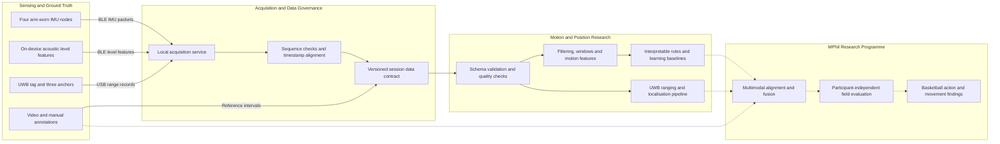

# Motion Lab — Public Research Version

Motion Lab is an in-progress research framework for studying wearable sensing,
player motion, and indoor localisation in basketball. This public version is
prepared to communicate the scope, technical progress, and proposed research
methodology of an MPhil project. It is a research repository, not a product
portfolio or a claim of a completed commercial system.

The current prototype combines four arm-worn IMU nodes, one UWB tag, three UWB
anchors, privacy-preserving acoustic level features, and optional video-derived
labels.

## Research motivation

The project investigates whether low-cost wearable sensing can support robust
recognition of basketball actions and court movement outside a controlled
laboratory. The research focus is the full sensing chain: acquisition,
timestamping, wireless transport, synchronisation, data quality, multimodal
alignment, feature learning, evaluation, and reproducibility.

## Current prototype

- 4 × Seeed Studio XIAO nRF52840 Sense nodes
- 100 Hz six-axis IMU streaming over BLE
- 16 kHz on-device PDM sampling reduced to RMS/peak features; no raw audio stored
- 1 × DWM3001CDK initiator/tag and 3 × responder/anchor nodes
- one-to-many DS-TWR ranging
- English-only local acquisition and monitoring console
- separate CSV streams with device, host-receive, and aligned timestamps

## Current research progress

| Area | Current state |
| --- | --- |
| Wearable sensing | Four-node IMU firmware and BLE packet format implemented |
| Indoor ranging | UWB tag/anchor capture tools and range schema implemented |
| Data engineering | Versioned schemas, timestamp handling, validation and synthetic examples implemented |
| Motion analysis | Filtering, temporal windowing, interpretable features and rule baselines implemented |
| Modelling | Leakage-aware classical baseline and grouped evaluation structure implemented |
| Multimodal supervision | Video pose and manual-label interfaces designed for later controlled studies |
| Research validation | Participant protocol, ground truth and field evaluation remain future MPhil work |

## Research system architecture



Solid arrows represent the implemented acquisition and processing foundation.
Dashed arrows identify integration and validation work proposed for the MPhil
research programme.

## Repository contents

```text
configs/                     Reproducible pipeline configuration
docs/                        Research overview, data contract, security and governance
examples/synthetic_session/  Non-participant example data
firmware/                    XIAO sensing firmware
research_console/            English local acquisition and monitoring console
scripts/                     English reproducible processing and capture tools
src/lykon_motion/             Loaders, preprocessing, features, rules and models
tests/                       Data-contract and leakage-prevention tests
```

## Implemented analysis pipeline

The repository contains an executable baseline rather than only acquisition
code:

```text
raw IMU CSV
  -> schema validation and canonical timestamps
  -> Butterworth low-pass filtering
  -> fixed-length overlapping windows
  -> statistical, peak-count and dominant-frequency features
  -> interpretable basketball rules or Random Forest baseline
  -> participant/session-grouped research evaluation
```

Implemented safeguards include explicit legacy/v2 data contracts, synchronized
timestamp fallback, rejection of random window-level train/test splitting,
train/test group-overlap checks, and isolation of synthetic demonstration
outputs. See [Algorithm pipeline](docs/ALGORITHM_PIPELINE.md) for the methods,
code map, reproducibility commands and current research limitations.

The included synthetic session demonstrates the software interfaces and
reproducible workflow. It is not participant evidence. Controlled data
collection and participant-independent validation form part of the proposed
research programme.

## Quick start

```bash
python3 -m venv .venv
source .venv/bin/activate
pip install -r requirements.txt
PYTHONPATH=src python -m unittest discover -s tests -v
python research_console/server.py
```

Open `http://127.0.0.1:8765/` for the English Research Console. Real hardware
serial numbers belong in the ignored `configs/device_registry.local.json`; the
committed example contains placeholders only.

## Data policy

This release contains synthetic examples only. It excludes participant names,
identity mappings, raw or derived participant sensor files, video, real labels,
precise collection metadata, device serial numbers, and local experiment notes.
Controlled research data must be shared separately through institution-approved
storage and governed by the applicable consent and ethics protocol.

Optional video-pose experiments use additional packages:

```bash
pip install -r requirements-vision.txt
```

## Research status

This repository documents the implemented foundation and the next research
steps. UWB localisation still requires anchor surveying and calibration;
BLE/UWB behaviour requires structured field studies; and action-recognition
experiments require independently annotated participant recordings. These open
questions define the intended MPhil research rather than omissions being hidden
from the reader.

