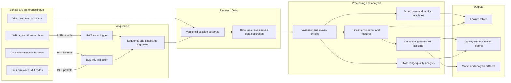

# Motion Lab — Public Research Version

Motion Lab is my technical research codebase for wearable basketball sensing.
It connects arm-worn inertial sensors, UWB ranging, optional video labels, and a
Python analysis pipeline. The repository shows the system structure and the
parts I have built so far; participant recordings remain in controlled storage.

## What I built

- firmware for four Seeed Studio XIAO nRF52840 Sense nodes;
- 100 Hz accelerometer and gyroscope streaming over BLE;
- on-device microphone RMS/peak features without storing raw audio;
- DWM3001CDK tag-to-anchor ranging capture tools;
- device, host-receive, and aligned timestamps in versioned CSV schemas;
- validation, Butterworth filtering, temporal windows, motion features, and
  interpretable basketball rules;
- a Random Forest baseline with participant/session grouping instead of random
  window splitting;
- optional video-pose extraction and motion-template scripts;
- a local browser console for capture and monitoring.

## Technical architecture



## Evidence level

The labels below separate code availability from experimental evidence.

| Component | Status | Evidence in this repository |
| --- | --- | --- |
| IMU BLE firmware | Implemented | Arduino source and packet definition |
| UWB ranging capture | Implemented | Serial/CLI capture tools and range schema |
| Data contracts and timestamp fallback | CI-tested | Schema tests and synthetic CSV fixtures |
| Filtering and feature pipeline | Sample-tested | Executable synthetic-data workflow |
| Random Forest baseline | Sample-tested | Group-split and synthetic opt-in tests |
| Research console | Implemented | Local server and browser interface |
| Video-pose tools | Experimental | Optional scripts; no automated hardware test |
| Participant-level field results | Not included | Requires controlled recordings and annotations |

Here, **Implemented** means code is present, **CI-tested** means automated tests
exercise the behaviour, and **Sample-tested** means the path runs on the bundled
synthetic session. These terms do not imply field validation.

## Repository map

```text
configs/                     Pipeline and rule configuration
docs/                        Data contract, methods, security, and schemas
examples/synthetic_session/  Small fictional dataset for exercising interfaces
firmware/                    XIAO sensing firmware
research_console/            Local acquisition and monitoring interface
scripts/                     Processing, capture, UWB, and video-pose entry points
src/lykon_motion/             Reusable loaders, preprocessing, features, rules, models
tests/                       Data-contract and split-safety tests
```

## Run the software path

```bash
python3 -m venv .venv
source .venv/bin/activate
pip install -r requirements.txt

PYTHONPATH=src python -m unittest discover -s tests -v
python scripts/01_generate_dummy_data.py
python scripts/02_build_features.py
python scripts/03_train_baseline.py --allow-synthetic
python scripts/04_run_rules.py
```

Start the local console with:

```bash
python research_console/server.py
```

Then open `http://127.0.0.1:8765/`. Video-pose experiments require
`pip install -r requirements-vision.txt`.

## Design choices

- Raw sensor records, labels, and derived features are stored separately.
- Original device and host timestamps are retained after alignment.
- Failed UWB measurements remain recorded with an explicit status.
- Model evaluation groups windows by participant or session to reduce leakage.
- Synthetic data requires an explicit `--allow-synthetic` flag for training.
- Public examples use fictional identifiers; participant data and device serial
  numbers are not committed.

## Current boundary

The repository contains the acquisition and analysis framework. Surveyed-anchor
2D localisation, larger annotated participant studies, and independent field
evaluation are not presented as completed results.

More detail is available in [the algorithm pipeline](docs/ALGORITHM_PIPELINE.md),
[the data contract](docs/DATA_CONTRACT.md), and
[the research overview](docs/RESEARCH_OVERVIEW.md).
